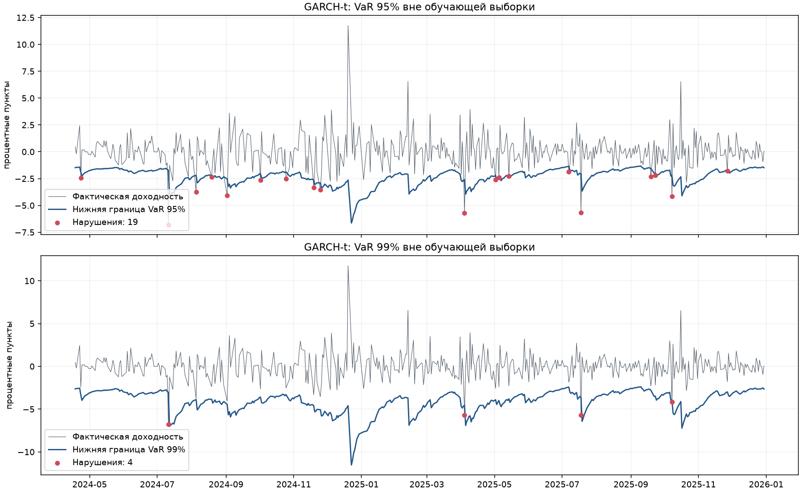

# GARCH VaR: прогноз волатильности и оценка риска акций Сбербанка

[Публичный репозиторий на GitHub](https://github.com/miijji/garch-var-sber) · [Выполненный ноутбук](outputs/garch_var_research.ipynb)


> **Начинайте каждую сессию работы с чтения [AGENTS.md](AGENTS.md) — постоянных правил ведения проекта.**

Исследование дневных цен Сбербанка: логарифмические доходности, диагностика, GARCH(1,1), VaR 95%/99%, последовательный бэктестинг и Expected Shortfall. Есть нормальные ошибки, стандартизированные ошибки Стьюдента и исторический VaR для сравнения.

**Первая версия разработана и проверена:** 26 автоматических тестов, полный запуск всех 9 вычислительных ячеек ноутбука, 500 прогнозов для каждой из трёх моделей. [Выводы](outputs/REPORT.md), [таблица бэктестинга](outputs/backtest_summary.csv), [подробности запуска](outputs/RESULTS.md).

## Задача и подход

Цель — проверить, насколько GARCH(1,1) помогает оценивать риск следующего торгового наблюдения. Проект прогнозирует условную волатильность и нижние квантили доходности, затем сопоставляет их с фактическими потерями.

Реализован полный цикл:

1. Загрузка дневных свечей SBER с Мосбиржи или импорт CSV.
2. Проверка качества и расчёт логарифмических доходностей.
3. EDA, ADF/KPSS, ACF/PACF доходностей и квадратов, ARCH-LM.
4. GARCH(1,1) с нормальными и стандартизированными ошибками Стьюдента.
5. Прогнозы VaR/ES на уровнях 95% и 99% на расширяющемся окне.
6. Сравнение с историческим VaR, тесты Купика, Кристофферсена и точный биномиальный тест.
7. Отчёт, графики, таблицы и автоматические проверки.

## Данные и схема проверки

| Параметр | Значение |
| --- | --- |
| Актив | SBER, обыкновенные акции Сбербанка, MOEX TQBR |
| Источник первой версии | MOEX ISS, дневные свечи |
| Фактическая история цен | 04.01.2016–30.12.2025 |
| Цены / доходности | 2577 / 2576 наблюдений |
| Первоначальное обучение | 2076 доходностей, до 17.04.2024 |
| Отложенный период | 18.04.2024–30.12.2025, 500 наблюдений |
| Схема прогноза | Расширяющееся окно, переоценка на каждом шаге |
| Горизонт | Следующее торговое наблюдение |

Для прогноза на дату `t` используются данные только до `t-1`. Тестовая доходность добавляется в историю после построения прогноза. Первоначальная EDA проводится на обучении.

## Результаты

| Модель | Уровень VaR | Ожидалось нарушений | Получено | Частота | p-value Купика |
| --- | --- | --- | --- | --- | --- |
| GARCH, Normal | 95% | 25 | 15 | 3.0% | 0.0271 |
| GARCH, Normal | 99% | 5 | 6 | 1.2% | 0.6630 |
| GARCH, Student-t | 95% | 25 | 19 | 3.8% | 0.1994 |
| GARCH, Student-t | 99% | 5 | 4 | 0.8% | 0.6414 |
| Исторический VaR | 95% | 25 | 9 | 1.8% | 0.0002 |
| Исторический VaR | 99% | 5 | 1 | 0.2% | 0.0282 |

При значимости 5% тест Купика не отвергает частоту нарушений GARCH-t на обоих уровнях. У нормальной модели на уровне 95% и у исторического VaR нарушений существенно меньше ожидаемого по этому тесту: границы получились консервативными. Небольшое число нарушений само по себе не означает лучшую калибровку.

На уровне 99% выводы чувствительны к малому числу событий. Для исторического VaR точный биномиальный тест даёт p ≈ 0.0709 и не отвергает гипотезу при 5%, в отличие от асимптотического теста Купика. Оба результата сохранены; вывод о качестве не сводится к одному p-value.

По квантильной потере GARCH-t лучше normal на 95% (0.1587 против 0.1617), а normal немного лучше на 99% (0.05424 против 0.05451). Поэтому проект не объявляет одну модель универсально лучшей.



[Полный отчёт](outputs/REPORT.md) · [Таблица результатов](outputs/backtest_summary.csv) · [Тесты стационарности](outputs/stationarity.csv) · [Параметры и происхождение данных](outputs/reproducibility.json)

## Быстрый старт после клонирования

Нужны Git и Python. Проверенная платформа — Windows, Python 3.13.9; можно использовать Python из Anaconda. Откройте терминал в каталоге репозитория:

```powershell
python -m venv .venv
.\.venv\Scripts\python.exe -m pip install -r requirements-lock.txt
.\.venv\Scripts\python.exe -m pip install --no-deps --no-build-isolation -e .
.\.venv\Scripts\python.exe -m ipykernel install --prefix .venv --name garch-var --display-name "Python (GARCH VaR .venv)"
.\.venv\Scripts\python.exe -m jupyterlab outputs/garch_var_research.ipynb
```

В первый раз нужен интернет: котировки автоматически загружаются из MOEX. Следующие запуски используют локальный кэш. Команды не требуют активации окружения.

## Открыть в Visual Studio Code

1. Откройте этот каталог как папку проекта.
2. Откройте [ноутбук](outputs/garch_var_research.ipynb).
3. Справа сверху выберите **Select Kernel → Python Environments → .venv\Scripts\python.exe**. Название установленного локального ядра — **Python (GARCH VaR .venv)**. При необходимости установите расширения Microsoft Python и Jupyter в VS Code.
4. Нажмите **Run All**. Параметры актива, периода, тестовой выборки и CSV находятся в начале ноутбука.

Создано отдельное окружение `.venv` на Python 3.13.9 из установленной Anaconda. Основное окружение Anaconda не изменяется. Активация в терминале не обязательна: команды ниже явно используют Python проекта.

## Запуск из терминала

Выполняйте команды из корня проекта:

```powershell
# JupyterLab в браузере
.\.venv\Scripts\python.exe -m jupyterlab outputs/garch_var_research.ipynb

# Полное исследование без интерфейса, обе модели и 500 дней проверки
.\.venv\Scripts\python.exe -m garch_var

# Быстрая проверка запуска (не полноценный бэктест)
.\.venv\Scripts\python.exe -m garch_var --test-size 20 --distribution normal

# Проверки
.\.venv\Scripts\python.exe -m pytest -q
```

Каждый расчёт создаёт отдельную папку в `outputs/runs/` с настройками, версиями библиотек, графиками, прогнозами, диагностикой, таблицами бэктеста и REPORT.md. Прошлые запуски не перезаписываются. Ноутбук с сохранёнными результатами расположен в `outputs/`.

## Данные и Kaggle

По умолчанию загружаются дневные свечи SBER, режим TQBR, за 2016–2025 годы из [MOEX ISS](https://iss.moex.com/iss/reference/). Локальный снимок в `data/raw/` содержит нормализованный CSV, исходный ответ и метаданные с контрольными суммами. Повторный запуск использует кэш без сети. Для новой версии данных укажите другой период; существующий снимок автоматически не заменяется.

На Kaggle найден [RUSSIA 249 Stocks Prices MOEX](https://www.kaggle.com/datasets/olegshpagin/russia-stocks-prices-ohlcv). Для первой версии выбран прямой источник одного актива. Для использования Kaggle скачайте отдельный дневной CSV одного актива и задайте его в начале ноутбука либо используйте:

```powershell
.\.venv\Scripts\python.exe -m garch_var --csv data/raw/SBER_D1.csv --date-column datetime --price-column close --source-url "https://www.kaggle.com/datasets/olegshpagin/russia-stocks-prices-ohlcv"
```

Названия столбцов должны соответствовать фактическому файлу. Для другого разделителя укажите `--sep ";"`. Для другого периода — `--start YYYY-MM-DD --end YYYY-MM-DD`. Все параметры: `python -m garch_var --help` через Python проекта.

Цены должны быть положительными, даты — уникальными; строки сортируются. Пропуски и дубликаты вызывают ошибку. Неторговые дни не заполняются, экстремальные доходности не удаляются. Котировки не включаются в будущий Git-репозиторий; перед их распространением нужно проверить условия источника.

## Зависимости и восстановление окружения

Проверенная конфигурация — Windows, Python 3.13.9. [requirements-lock.txt](requirements-lock.txt) фиксирует установленные версии, [requirements.txt](requirements.txt) — допустимые диапазоны основных зависимостей.

Команды установки приведены в разделе «Быстрый старт после клонирования».

Те же действия доступны в [scripts/setup.ps1](scripts/setup.ps1). В первый раз нужен интернет для установки библиотек и получения котировок.

## Методика и ограничения

Доходности: `100 * ln(P_t / P_(t-1))`, единица — процентный пункт. Граница доходности `q = mu + sigma * F^(-1)(alpha)`; VaR убытка имеет противоположный знак. Нарушение: фактическая доходность ниже `q`.

Для каждого из 500 отложенных наблюдений модель заново обучается только на предыдущей истории. EDA и первоначальная диагностика используют обучающий период. Параметры исследования зафиксированы до оценки бэктеста. Финальный прогноз после последней исторической даты не является актуальным прогнозом на сегодня.

Тесты Купика и Кристофферсена оценивают частоту и зависимость нарушений; дополнительно сохранён точный биномиальный тест. Неотвержение гипотезы не доказывает качество, особенно при малом числе нарушений. Фактический средний убыток в дни нарушения — описательная оценка хвоста, а не полноценный тест ES.

Обычные цены закрытия не скорректированы на дивиденды. Перерывы торгов означают, что доходность между соседними наблюдениями может охватывать несколько календарных дней. Это исследование ценового риска, а не полной доходности инвестора.

## Структура и документация

- `src/garch_var/` — загрузка и проверка данных, модели, анализ, бэктестинг и запуск из терминала.
- `tests/` — проверки расчётов, времени прогнозов и загрузки данных.
- `outputs/` — итоговый ноутбук; `outputs/runs/` — локальные результаты отдельных запусков.
- `data/raw/` — снимки котировок; `work/` — промежуточные материалы.
- [Карта документации](docs/INDEX.md), [требования](docs/PROJECT.md), [статус](docs/STATUS.md), [задачи](docs/TASKS.md), [решения](docs/DECISIONS.md), [история изменений](docs/CHANGELOG.md).

Подробное [описание работы от первого лица](docs/PROJECT_STORY.md) и [словарь моделей, тестов и понятий](docs/GLOSSARY.md) дополняют ноутбук. Статус публикации хранится в [STATUS.md](docs/STATUS.md).


## Ключевые формулы

Логарифмическая доходность в процентных пунктах:

$$r_t = 100 \ln(P_t/P_{t-1}).$$

GARCH(1,1):

$$r_t=\mu+\epsilon_t,\quad \epsilon_t=\sigma_t z_t,$$
$$\sigma_t^2=\omega+a\epsilon_{t-1}^2+b\sigma_{t-1}^2.$$

Нижняя граница доходности при уровне доверия $c$ и хвостовой вероятности $\alpha=1-c$:

$$q_{t+1,\alpha}=\hat\mu_{t+1}+\hat\sigma_{t+1}F^{-1}(\alpha),\qquad VaR^{loss}_{t+1,c}=-q_{t+1,\alpha}.$$

Нарушение: $r_{t+1}<q_{t+1,\alpha}$. Квантили распределения Стьюдента масштабируются до единичной дисперсии. Для нормальных ошибок ES убытка:

$$ES^{loss}_{t+1,c}=-\hat\mu_{t+1}+\hat\sigma_{t+1}\frac{\varphi(\Phi^{-1}(\alpha))}{\alpha}.$$

## Проверки и воспроизводимость

26 тестов проверяют валидацию цен, пагинацию и кэш, контрольные суммы, отсутствие использования будущих данных, даты и единицы прогнозов, формулы ES через численное интегрирование, переходы нарушений и граничные случаи статистических тестов. Ноутбук выполнен полностью с чистым ядром; результаты дополнительно сверены с фактическими доходностями.

Исходные котировки, окружение, временные файлы и папки отдельных запусков не входят в репозиторий. В нём сохранены код, ноутбук с вычисленными результатами, агрегированные таблицы, графики, диагностические результаты и описание происхождения снимка. Машинные абсолютные пути в текстовых выводах ноутбука заменены на `<project>`; численные результаты не изменены.

## Источники и методика

- [MOEX ISS](https://iss.moex.com/iss/reference/) — котировки.
- [arch: прогнозирование и VaR](https://arch.readthedocs.io/en/stable/univariate/univariate_volatility_forecasting.html).
- [statsmodels: ADF](https://www.statsmodels.org/stable/generated/statsmodels.tsa.stattools.adfuller.html), [KPSS](https://www.statsmodels.org/stable/generated/statsmodels.tsa.stattools.kpss.html), [ARCH-LM](https://www.statsmodels.org/stable/generated/statsmodels.stats.diagnostic.het_arch.html), [Ljung–Box](https://www.statsmodels.org/stable/generated/statsmodels.stats.diagnostic.acorr_ljungbox.html).
- [SciPy: точный биномиальный тест](https://docs.scipy.org/doc/scipy/reference/generated/scipy.stats.binomtest.html).
- [Kupiec, 1995: Techniques for Verifying the Accuracy of Risk Measurement Models](https://fedinprint.org/item/fedgfe/34596/original).
- [Christoffersen, 1998: Evaluating Interval Forecasts](https://users.ssc.wisc.edu/~bhansen/718/Christoffersen1998.pdf).
